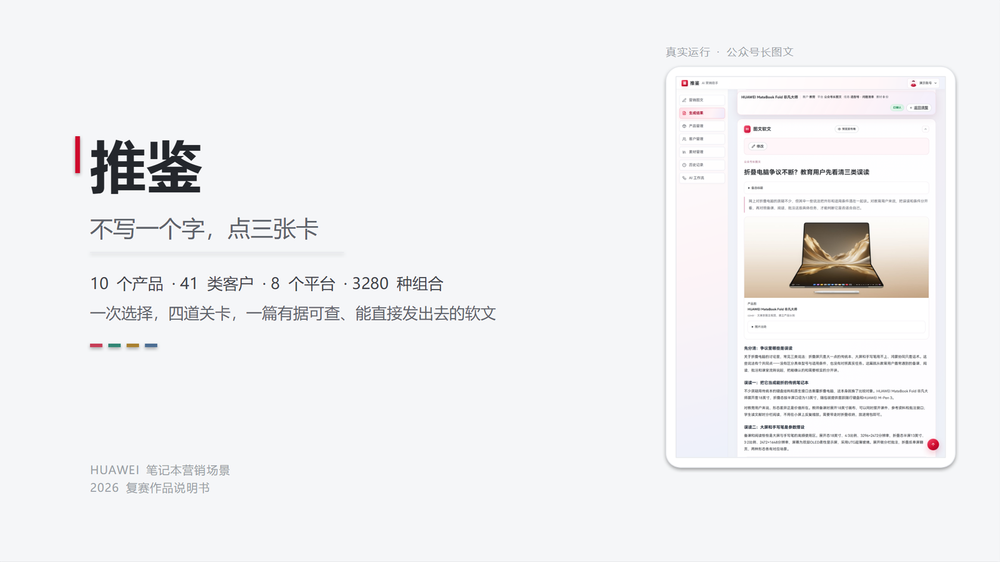
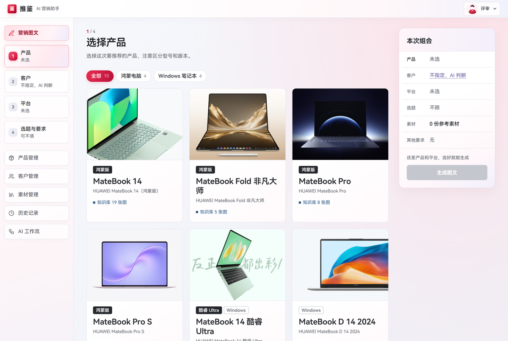
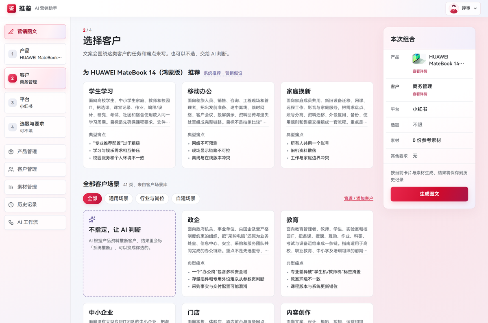
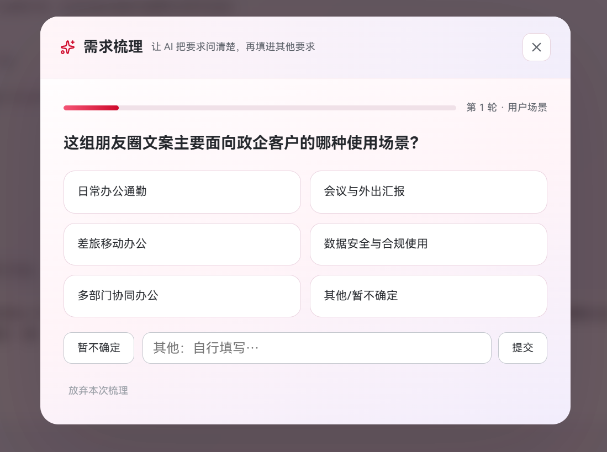
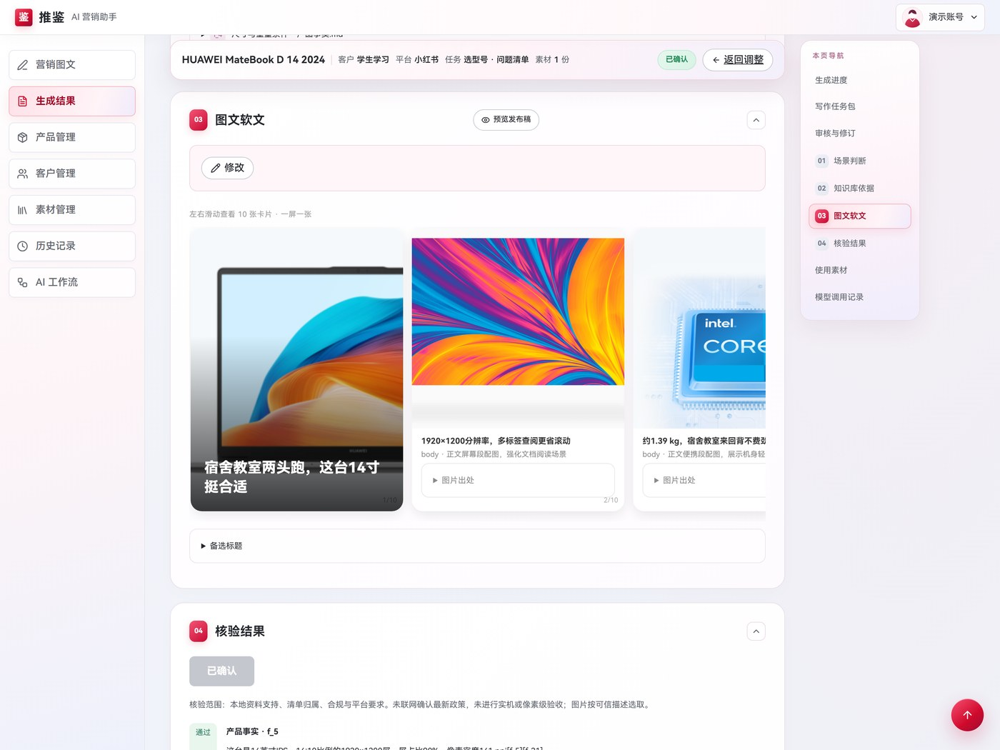
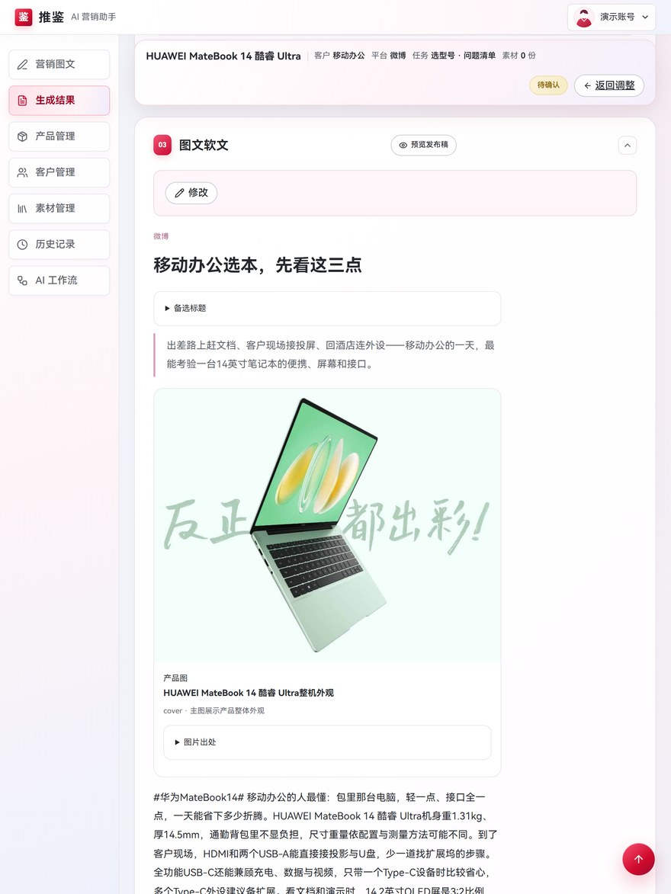
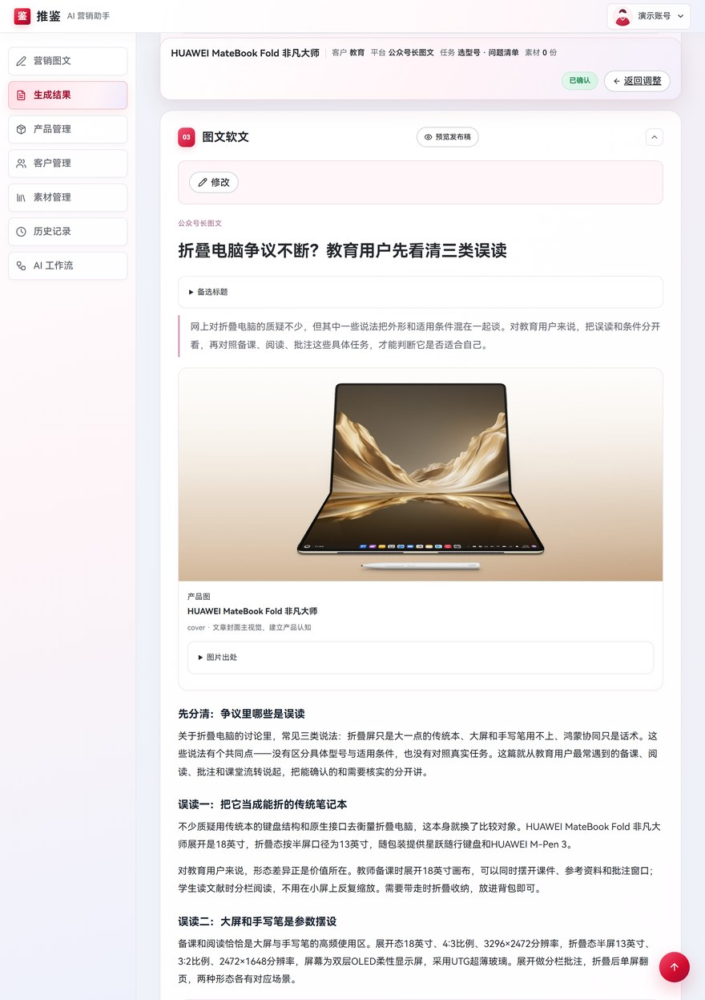
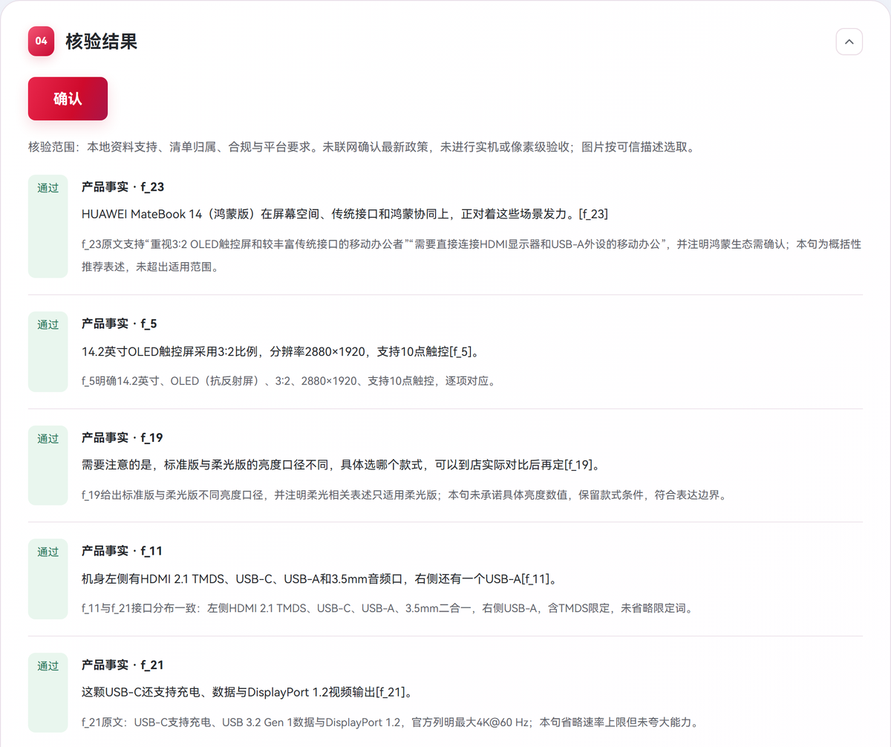
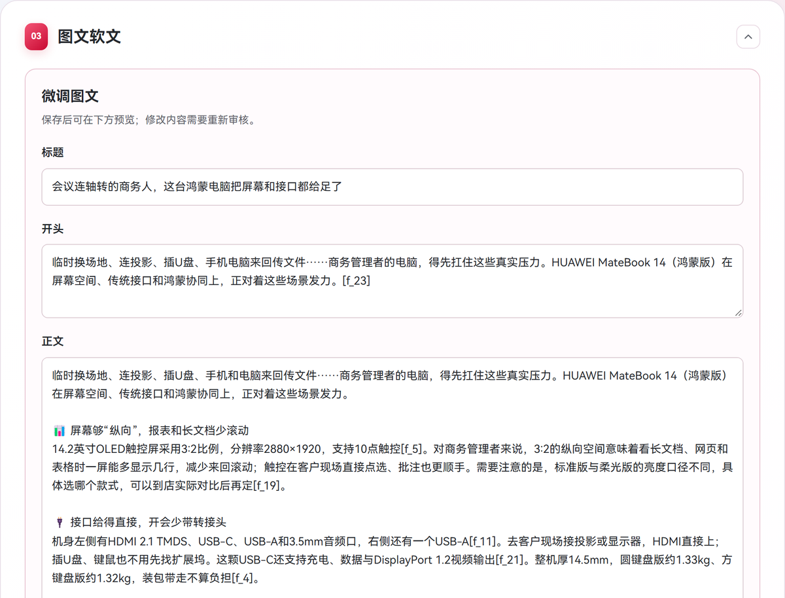

# 推鉴

**不写一个字，点三张卡，拿到一篇能直接发出去的多平台软文。**

[在线体验](https://wyh666a-tuijian.ms.show) · [快速开始](#快速开始) · [口径与限制](#口径与限制)

---

写一篇笔记本软文，最容易翻车的其实是三件事：**参数记错、平台语气不对、说了没依据的话**。
推鉴把这三件事收进同一条流程——产品、客户、平台全部卡片化，其余需求由 AI 逐个问出来，最后交一篇事实带出处、平台适配、可直接发布的稿子。

| 输入 | 组合 | 输出 |
|:---:|:---:|:---:|
| **0** 字手动输入 | **3280** 种组合 | **8** 套平台语体 |
| 全程点选 | 10 产品 × 41 客户 × 8 平台 | 公众号、微博、小红书、知乎、新闻稿、朋友圈、门店长图、采购方案 |

---

## 界面一览

### 选产品、选客户



*产品卡：型号精确到版本。客户卡 41 张，每张带场景描述、核心问题与资料出处。*



### 需求不用写，AI 逐个问



*一次只问一个问题，全部是可点选项；五问收成一张创作要求摘要，最多 7 轮、问满 5 个维度即可结束。*

### 出的稿子长这样



*小红书 · 学生学习 · MateBook D 14 2024 —— 869 字 / 4 图 / 10 张卡片流*



*微博 · 移动办公 · 14 酷睿 Ultra —— 546 字一口气写完，3 轮修订*



*公众号长图文 · 教育 · MateBook Fold 非凡大师 —— 导语 82 字 + 6 个分段小标题，1652 字，6 轮修订*

### 写完自己回查



*产品事实、图片型号、合规、平台适配四类逐条回查；正文的 `[f_5]` 编号由模型写、原文由程序回填。*

### 人改稿，人定稿



*标题、导语、正文、行动引导、话题标签都能就地改，配图可换可排序。*


*预览里看到的就是下载到的那份 HTML——两者共用同一个 `buildPublishDoc()`。*

---

## 快速开始

```bash
npm ci
cp .env.example .env          # Windows: copy .env.example .env

npm run dev                   # http://localhost:5173
npm run build && npm start    # 生产预览 http://localhost:7860
```

只需要一个密钥，其余均有默认值：

| 变量 | 必填 | 默认值 |
|---|:---:|---|
| `LLM_API_KEY` | 是 | — |
| `LLM_BASE_URL` | 否 | `https://api.openai-next.com/v1` |
| `LLM_MODEL` | 否 | `deepseek-v4.1-flash` |
| `KNOWLEDGE_ROOT` | 否 | 本仓库填 `./knowledge` |

需要 Node ≥ 22.5（用到内置 `node:sqlite`）。启动后访问 `GET /api/settings/llm`，返回 `defaultConfigured: true` 说明密钥已生效。

Docker：`docker build -t tuijian . && docker run -p 7860:7860 -e LLM_API_KEY=<key> tuijian`

---

## 口径与限制

只读**本地导出知识库（已获授权）**，不实时调用 ima；不做 AI 生图；图片只提供来源确认与型号归属校验，不宣称逐张人工复核；不承诺价格、补贴、销量、奖项与用户评价。

<details>
<summary>技术栈与目录</summary>

React 19 + Vite 6，服务端为 Vite 中间件（`/api/*`），没有独立后端进程；数据存 Node 内置 `node:sqlite`。

```
src/platform-layout.js        8 套平台版式与硬约束（前后端共用）
src/export.js                 buildPublishDoc：预览与下载共用同一份 HTML
server/revision-workflow.mjs  规划 → 创作 → 核验 → 修订
server/discovery.mjs          多轮需求梳理（5 维度 / 最多 7 轮）
knowledge/                    本地导出知识库（已获授权）
```

测试：`node --test server/article-flow.test.mjs server/card-deck.test.mjs server/publish-html.test.mjs server/platform-layout.test.mjs`

</details>

## 许可

参赛作品，代码供评审与交流使用。`knowledge/` 下的产品资料与图片版权归原权利人，不在开源许可范围内，请勿二次分发。
